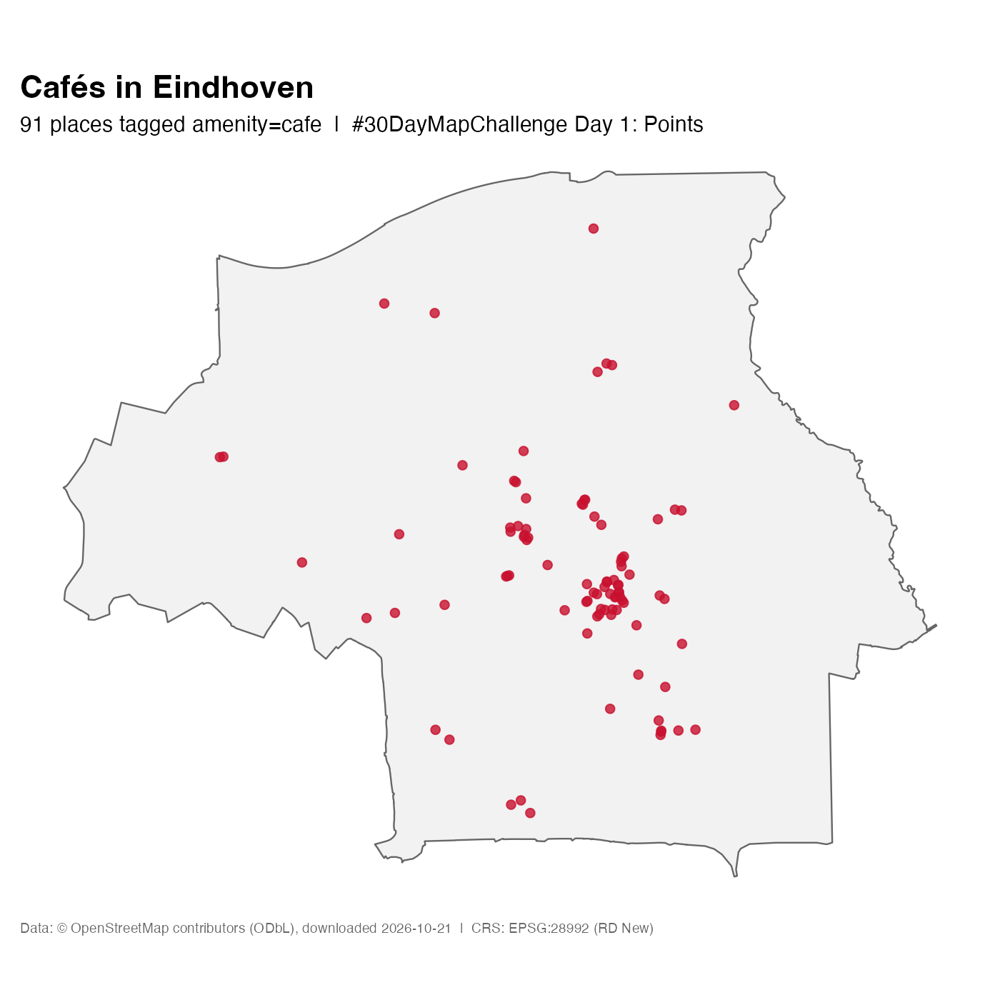

# Day 01 – Points



- **Name:** BE Coding Café (example submission)
- **Day / theme:** Day 01 – Points
- **Data sources:** OpenStreetMap, `amenity=cafe` and the Eindhoven municipal boundary via the Overpass API,
  downloaded 2026-10-21 (see [data/README.md](../../data/README.md)). © OpenStreetMap contributors, ODbL 1.0.
- **Tools:** R 4.4 + sf + ggplot2 (`day01_points.R`, identical to `r/day01_points.R`).
  A Python version is in `python/day01_points.py`.
- **CRS:** EPSG:28992 (Amersfoort / RD New)
- **AI disclosure:** An AI coding agent wrote the scripts and downloaded the data; the Coding Café organisers chose the theme, data and projection and checked the result.

## What I learned

91 OSM-tagged cafés, with a clear cluster in the city centre – and "points" maps
are mostly about deciding what counts as a point (here: whatever OSM tags `amenity=cafe`).

## How to reproduce

```bash
Rscript maps/day01-example/day01_points.R example
```
